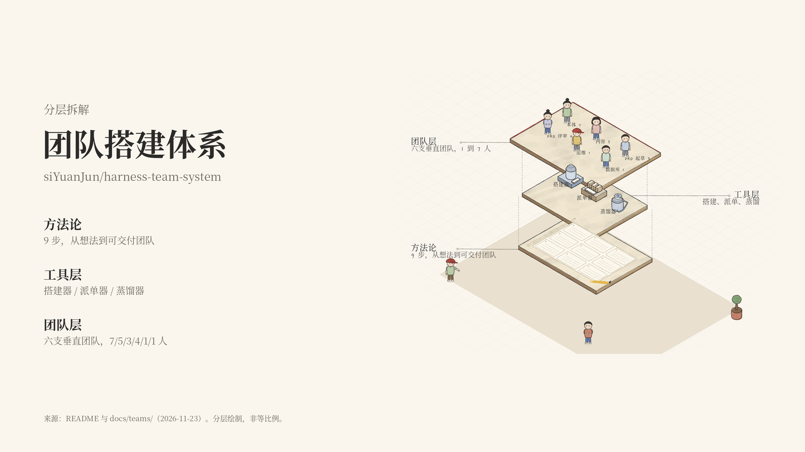

# siYuanJun

AI Agent 工程实践者，专注 Skill 工程与 Harness 编排——把 AI 从单次对话助手推进为可编排、可治理、可复用的工程化生产力。

---

## 核心方向

- **Skill 工程** —— 将方法论与工作流蒸馏为可复用的 Agent Skills
- **Harness 编排** —— 为任意项目构建可被 Claude Code 调度的多 Agent 团队
- **AI 应用落地** —— 面向真实场景的 AI 工具与产品

## 技能工程索引

技能工程仓 18 个：单技能 15、集合 1、内嵌 2，技能条目 31。
覆盖治理体检、测试验收、需求起草与评审、内容生产、本体建模、运维执行、交付编排七类场景。

逐仓登记见 [skills-index](https://github.com/siYuanJun/skills-index)：每个仓的性质、可见性、入口、技能数与用途各一行。索引只放清单，不放技能正文；被索引的仓保持各自原可见性。
可视化入口：[Skill Flow Viz](https://siyuanjun.github.io/skill-flow-viz/index.html)（技能执行脉络的单页拆解，可直接在线看）。

每个仓负责一段流程，触发边界、产出物与验收口径写在仓内；跨仓的分工由 Harness 编排。

## 精选项目

**体系与技能工程**

| 项目 | 说明 |
|---|---|
| [Harness Team System](https://github.com/siYuanJun/harness-team-system) | AI 多 Agent 团队体系：方法论 + 搭团队元工具 + 垂直团队分级 |
| [Open Skills Collection](https://github.com/siYuanJun/open-skills-collection) | 外部 Skill 索引与开源项目解析，持续增量收录 |
| [Skill Flow Viz](https://siyuanjun.github.io/skill-flow-viz/index.html) | 把 SKILL.md 执行脉络翻译为流程图与时间轴，可在线浏览 |
| [工程判定案例](https://siyuanjun.github.io/engineering-basis/) | 五类判定口的可跑切片：合入、发版、缺陷、需求、交付 |

**可视化展示**

| 项目 | 说明 |
|---|---|
| [Showcase](https://siyuanjun.github.io/showcase/) | 工程作品集索引：能力档案 ×4 + 可视化工程 ×5 |
| [CortexLab](https://github.com/siYuanJun/cortexlab) | 数字员工大脑架构：3D 人体隐喻与 SDK 解剖 |
| [Ontology-Brain Visual](https://siyuanjun.github.io/ontology-brain-visual/) | 本体工程师团队的 Dashboard、KPI 与时间轴 |

**产品应用**

| 项目 | 说明 |
|---|---|
| [Interview Tiger](https://github.com/siYuanJun/interview-tiger) | 浏览器内的 AI 面试辅助：实时转写并给出回答建议 |
| [Pressure Test Platform](https://github.com/siYuanJun/pressure-test-platform) | 网站压测：申请、审核、执行与报告生成 |

其中 Harness Team System 与 Open Skills Collection 暂未公开，入口保留在此。

### Harness Team System

方法论 9 步 → 三件元工具（搭建器、派单器、蒸馏器）→ 六支垂直团队。仓库内附可交互的分层拆解图，可逐状态查看一层层装配的过程。

## 技术栈

AI Agent · Skill 工程 · Harness 编排 · Claude Code · LLM · RAG · Python · TypeScript · React · FastAPI · Three.js

---

联系：siyuanjunr@qq.com
